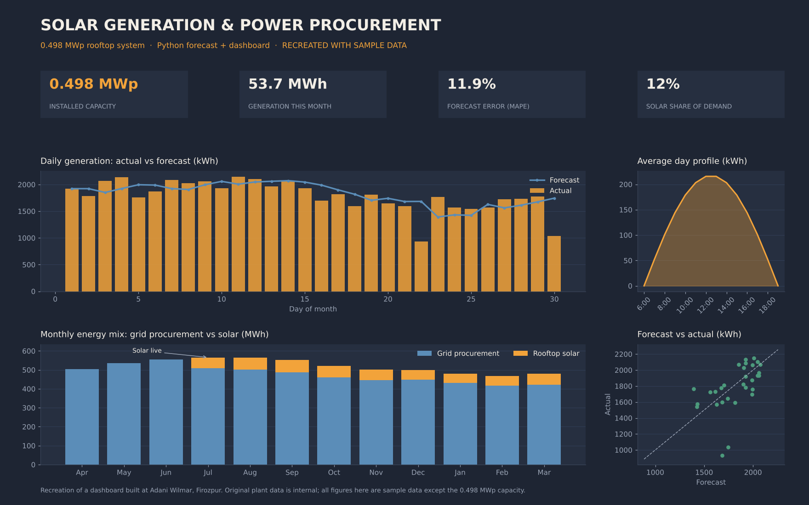

# Solar Energy Optimization & Procurement Savings Dashboard

> **Recreated with sample data.** I built the original at Adani Wilmar, Firozpur plant. Its plant data is internal, so this repo rebuilds the same forecast and dashboard on sample data. Only the 0.498 MWp capacity is the real figure.



## The real project (Adani Wilmar, Firozpur)
- Led a cross-functional project with **Adani Green & Waaree** to commission a **0.498 MWp rooftop solar system**.
- Built a **Python forecasting model** and a **Power BI dashboard** to monitor generation and schedule power procurement and usage.
- **Result:** better planning of energy needs and lower monthly procurement from external grid suppliers.

## What this repo shows
`solar_dashboard.py` generates a month of sample generation data for a 498 kWp system and draws:
- KPI tiles: capacity, monthly generation, forecast error (MAPE), solar share of demand
- Daily generation, actual vs forecast (3-day moving-average irradiance model)
- Average day generation profile
- Monthly energy mix: grid procurement vs rooftop solar
- Forecast vs actual scatter

```bash
pip install numpy pandas matplotlib
python solar_dashboard.py      # writes solar-dashboard.png
```

**Skills:** Python (pandas, matplotlib) · Forecasting · Power BI · Energy procurement planning · Cross-functional project execution

---
**Inder Lohani** — Operational Excellence Executive @ BakeMate · [Portfolio](https://inderlohani.github.io/Portfolio/) · [LinkedIn](https://www.linkedin.com/in/inder-lohani-5104141ab)
